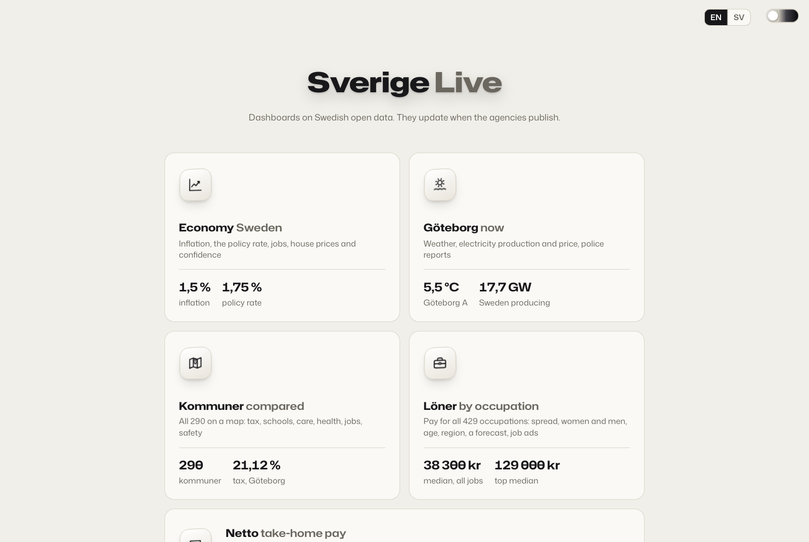
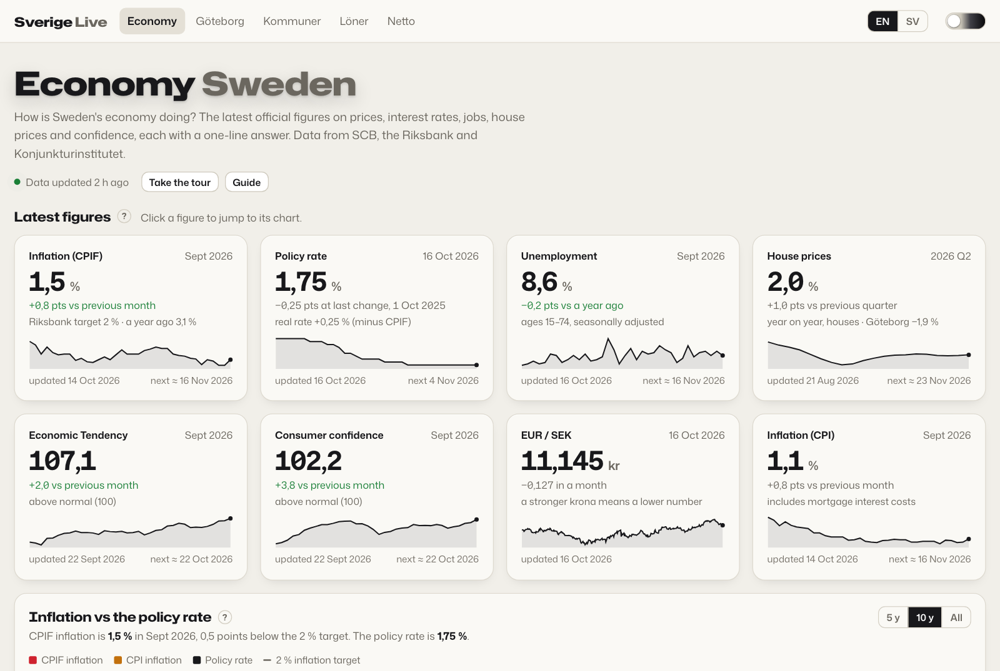
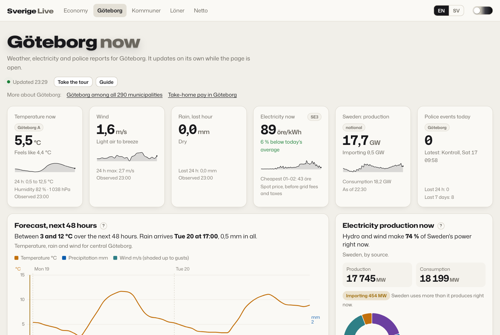
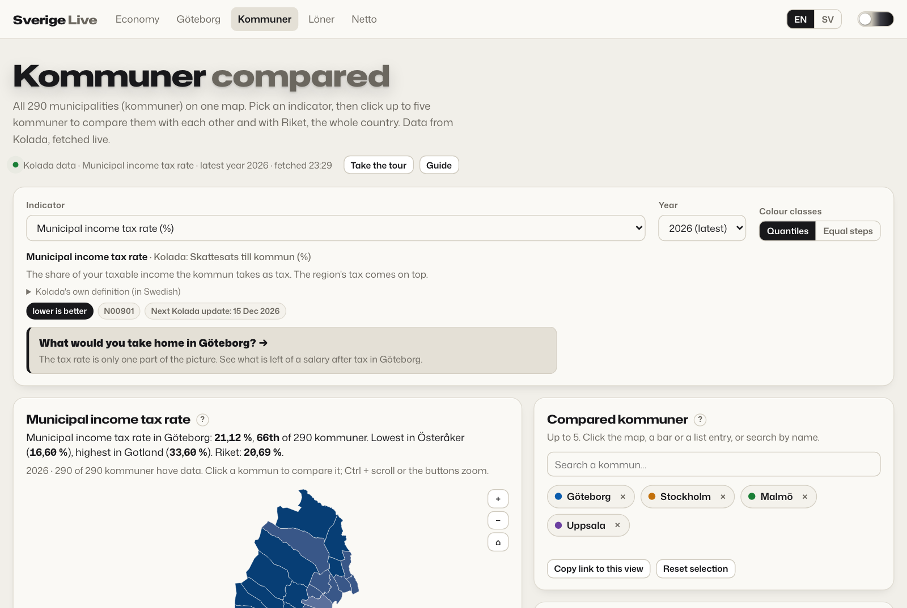
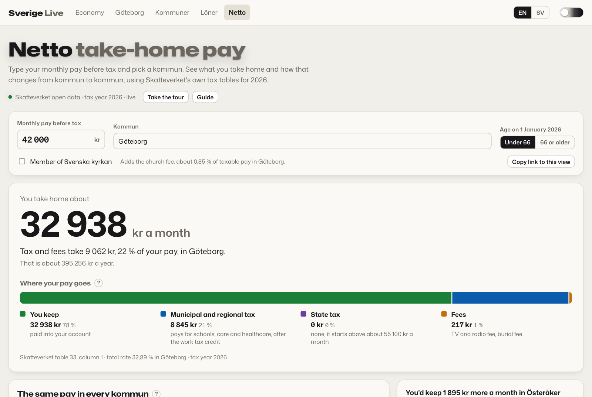
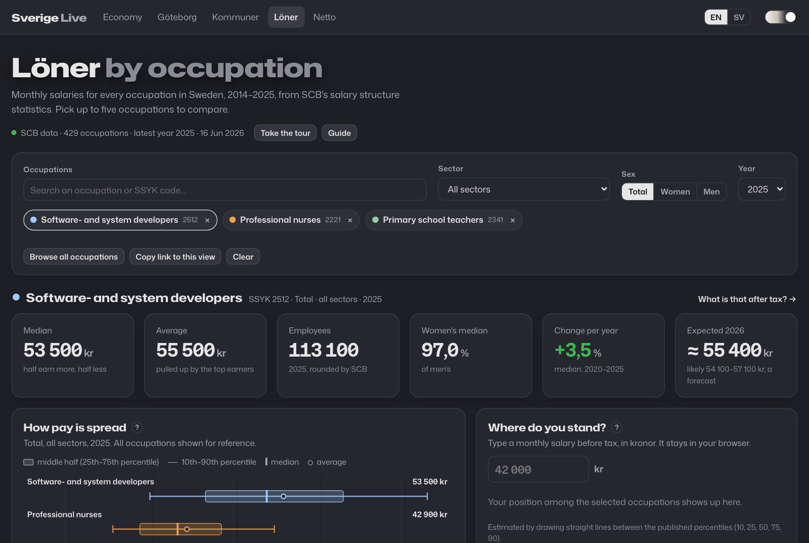
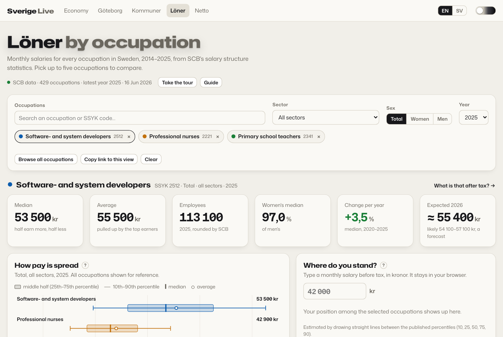
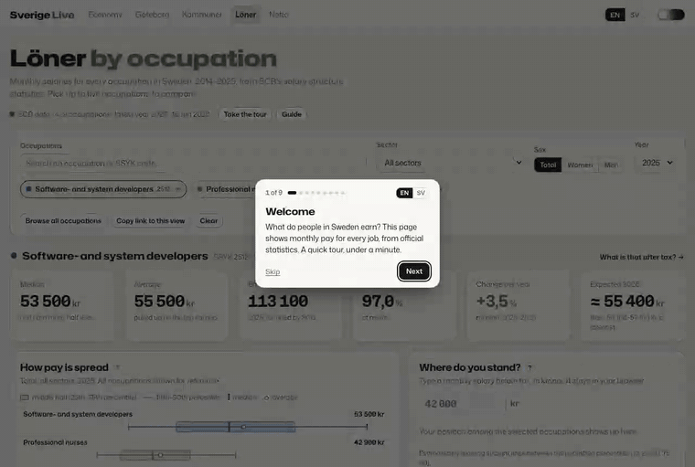
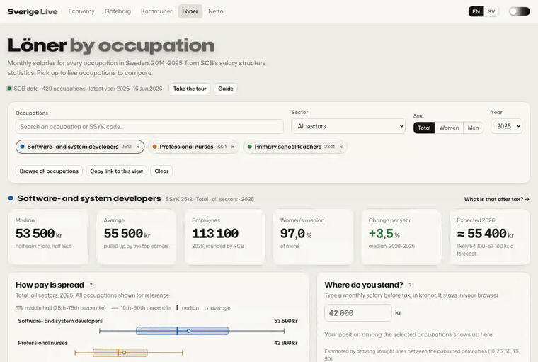
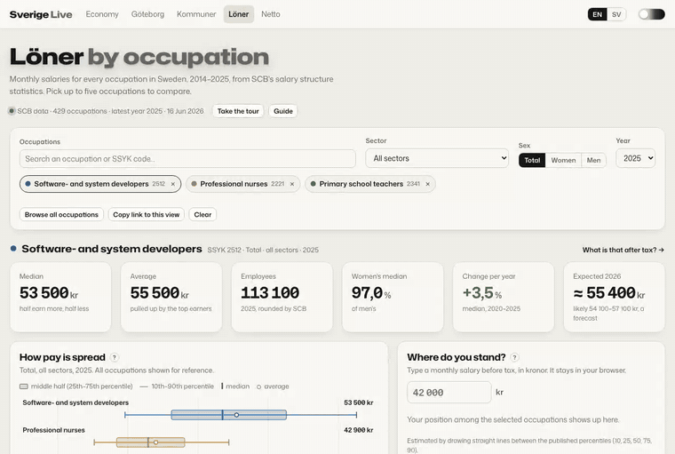

# Sverige Live

Dashboards on Swedish open data. They update when the agencies publish.

**Live site: https://rajathpi.github.io/sverige-live/**

| Dashboard | What it shows | Data | How it stays current |
|---|---|---|---|
| [Economy](https://rajathpi.github.io/sverige-live/economy/) | Inflation (CPIF, CPI) against the policy rate, unemployment, house prices by region, business and consumer confidence, EUR/SEK, and a calendar of the next releases | SCB, Sveriges Riksbank, Konjunkturinstitutet | GitHub Action, three times every weekday |
| [Göteborg](https://rajathpi.github.io/sverige-live/goteborg/) | Weather now and the next 48 hours, Sweden's electricity production by source this hour, the SE3 electricity price, police reports | SMHI, Svenska kraftnät, Polisen, elprisetjustnu.se | Fetched in the browser, refreshed while the page is open |
| [Kommuner](https://rajathpi.github.io/sverige-live/kommuner/) | All 290 municipalities on a map for taxes, schools, elder care, health, jobs and safety; pick any and compare them | Kolada (RKA) | Fetched in the browser on every visit |
| [Löner](https://rajathpi.github.io/sverige-live/loner/) | Monthly pay for all 429 occupations, 2014–2025: percentiles, women and men, trends with a tested three-year forecast, age, education, region, leaderboards, where your own salary lands, and open job ads | SCB, Arbetsförmedlingen (JobTech) | Nightly snapshot for the default view, the rest fetched in the browser |
| [Netto](https://rajathpi.github.io/sverige-live/netto/) | Take-home pay for any monthly salary in any kommun, from Skatteverket's official 2026 tax tables, and the same salary across all 290 kommuner on a map | Skatteverket | Fetched in the browser on every visit |

Every dashboard has a short first-visit tour, a guide to its charts and terms (the **?** next to each heading), English and Swedish, a one-line answer under each chart, and "Show as table" for anyone who wants the exact numbers or uses a screen reader. The pages link to each other where it helps, for example from a salary in Löner to what it leaves after tax in Netto. The site installs as an app on a phone or desktop and shows the last data it loaded when you are offline.

## What's on the site

| | |
|---|---|
| [](https://rajathpi.github.io/sverige-live/) **Landing page.** One live figure from each dashboard. | [](https://rajathpi.github.io/sverige-live/economy/) **Economy.** Inflation against the policy rate, jobs, house prices, confidence and the next release dates. |
| [](https://rajathpi.github.io/sverige-live/goteborg/) **Göteborg.** Weather now and for 48 hours, the electricity price and power mix, police reports. | [](https://rajathpi.github.io/sverige-live/kommuner/) **Kommuner.** All 290 municipalities on a map; pick up to five and compare them. |
| [](https://rajathpi.github.io/sverige-live/netto/) **Netto.** What a salary leaves after tax in your kommun, and in every other one. | [](https://rajathpi.github.io/sverige-live/loner/?theme=dark) **Light and dark.** Every page follows the theme switch. |

### Löner, salaries by occupation

[](https://rajathpi.github.io/sverige-live/loner/)

**First visit: a short tour.** It shows once, after the charts load, and points at each part of the page in a sentence or two. "Take the tour" in the header replays it.



**Compare jobs and see where your salary lands.** Search or browse all 429 occupations, pick up to five, and type a monthly salary to see roughly which percentile you would be in for each. The salary never leaves your browser.



**The guide explains every chart and term.** Open it from "Guide" in the header or from the small **?** next to any chart title. It covers how to read each chart, what median, percentile and the sectors mean, the data's limits, and where it comes from.



**A forecast that has been tested.** The dashed lines on "Over time" forecast the median three years ahead. Swedish pay moves together through the national wage agreements, so the model follows national pay growth and expects part of an unusual one-year jump to even out. It was chosen by forecasting past years and comparing with what SCB later published: tuned on 2019–2021 and scored on 2022–2024, which the tuning never saw, it was off by 2,3 % one year ahead and 4,2 % three years ahead, against 2,9 % and 6,2 % for simply carrying the last five years forward. The shaded band is the range that held about 8 in 10 real outcomes in that test. The numbers are recomputed nightly and stored in `data/loner-forecast.json` under `backtest`.

Plain HTML, CSS and JavaScript with [D3](https://d3js.org) for the charts. No build step, no tracking, no API keys. The look (Mona Sans, Hubot Sans, the light/dark switch) is the theme kit from [Studio Hub](https://github.com/rajathpi/studio-hub).

## How the data stays live

Some agencies send the CORS headers a web page needs, so those pages call the
APIs directly from your browser:

- SMHI open data, Svenska kraftnät's control room, Polisen's events API, Kolada, SCB's PxWebApi, JobTech and Skatteverket's open data are fetched by `goteborg/`, `kommuner/`, `loner/` and `netto/` every time the page opens. `goteborg/` also refreshes on a timer while it stays open (paused when the tab is hidden), and `economy/` reloads its data when you come back to a tab left open for more than 30 minutes.
- Löner's default view (all sectors) comes from a nightly snapshot, [`data/loner.json`](data/loner.json), so the page draws without waiting on SCB; other sectors and the age, education and region breakdowns are still fetched live. [`scripts/update_loner.py`](scripts/update_loner.py) writes it and [`scripts/forecast_loner.py`](scripts/forecast_loner.py) writes the forecast, both from [`.github/workflows/loner-data.yml`](.github/workflows/loner-data.yml) at 04:10 UTC, committing only when something changed.

The Riksbank's SWEA API and Konjunkturinstitutet's statistics database cannot be
called from a browser, so the economy figures are collected by a scheduled job:

- [`.github/workflows/update-data.yml`](.github/workflows/update-data.yml) runs [`scripts/update_economy.py`](scripts/update_economy.py) at 07:20, 09:20 and 14:20 UTC on weekdays. That catches SCB's 08:00 releases, the Riksbank's 09:30 decisions and Konjunkturinstitutet's morning publications within a couple of hours.
- The script writes [`data/economy.json`](data/economy.json) and only commits when a number actually changed, so the history shows one commit per real release.
- Upcoming Riksbank decisions are read from the Riksbank's public calendar. SCB and Konjunkturinstitutet dates are estimated from each agency's regular rhythm and shown as "≈ expected".

Run it yourself (Python 3.9+, standard library plus optional `certifi`):

```bash
python scripts/update_economy.py
```

## Automation

- [`update-data.yml`](.github/workflows/update-data.yml) refreshes `data/economy.json` on weekdays (see above), and [`loner-data.yml`](.github/workflows/loner-data.yml) refreshes Löner's snapshot and forecast every night.
- [`site-check.yml`](.github/workflows/site-check.yml) loads every page in Chromium ([`scripts/check_site.mjs`](scripts/check_site.mjs)) and flags console errors, failed data requests, error messages, `NaN`/`undefined` text and cards stuck on "Loading". It runs daily at 06:30 UTC against the live site and on every push to `main` against the pushed commit. A failing daily run opens (or comments on) an issue labelled `site-check` and closes it when the check passes again.
- [`screenshots.yml`](.github/workflows/screenshots.yml) re-captures `docs/screens/` on the 1st of each month with [`scripts/capture_screens.mjs`](scripts/capture_screens.mjs). Run it by hand with "gifs" ticked to re-record the Löner GIFs too. `--og` writes the link-preview images in `assets/og/`.
- Run the scripts locally with `npm i --no-save playwright@1.61.1 && npx playwright install chromium` while the site is served on port 8765: `node scripts/check_site.mjs` or `node scripts/capture_screens.mjs --out /tmp/screens [--gifs]` (GIFs need `ffmpeg`).

## Repository layout

```
index.html                  landing page with a live figure from each dashboard
manifest.webmanifest, sw.js the installable app and its offline cache
assets/css/kit.css          Studio Hub theme kit: fonts, light/dark tokens, theme switch
assets/css/base.css         layout, cards, KPI tiles, charts
assets/css/guide-kit.css    tour, guide panel and "Show as table" styles
assets/js/theme.js          the light/dark switch (shares its setting with Studio Hub)
assets/js/core.js           shared helpers: fetch with cache, formatting, tooltip, language, "Show as table"
assets/js/guide-kit.js      the first-visit tour and the guide panel every page configures
assets/geo/kommuner.geojson simplified municipality borders
assets/icons/, assets/og/   app icons and link-preview images
economy/ goteborg/ kommuner/ loner/ netto/
                            one folder per dashboard: index.html, the page script, i18n.js (English and
                            Swedish text, tour and guide content) and guide.js (which element each tour step points at)
data/economy.json           written by update-data.yml
data/loner.json             Löner snapshot, written by loner-data.yml
data/loner-forecast.json    Löner forecast and its backtest, written by loner-data.yml
scripts/                    the data jobs, the site check and the screenshot capture
.github/workflows/          the schedules
docs/screens/               the screenshots and GIFs in this README
```

## Run locally

Any static server works; the pages use relative paths and `fetch`, so opening the files directly from disk will not load the data.

```bash
python -m http.server 8000
```

Then open http://localhost:8000/.

## Data sources and terms

The code is MIT licensed (see [LICENSE](LICENSE)). The data belongs to the publishers below; each dashboard names its source next to every chart.

| Source | Used for | Terms |
|---|---|---|
| [SCB, Statistics Sweden](https://www.scb.se/en/) (PxWebApi 2.0) | CPIF, CPI, Labour Force Survey, real estate price index, salary structure statistics | Open data, CC0 |
| [Arbetsförmedlingen, JobTech](https://jobtechdev.se) (JobSearch, Taxonomy) | Open job ads per occupation | Open data, source named |
| [Sveriges Riksbank](https://www.riksbank.se/en-gb/statistics/) (SWEA API, calendar) | Policy rate, EUR/SEK, decision dates | Free to use with the source named |
| [Konjunkturinstitutet](https://www.konj.se/english.html) (statistics database) | Economic Tendency Indicator, consumer confidence | Free to use with the source named |
| [SMHI Open Data](https://www.smhi.se/data) | Observations at Göteborg A, SNOW1g point forecast | CC BY 4.0 |
| [Svenska kraftnät](https://www.svk.se/om-kraftsystemet/kontrollrummet/) | Production by source and consumption, from the control room | Public data, source named |
| [Polisen](https://polisen.se/om-polisen/om-webbplatsen/oppna-data/) | Police events | Open data, source named |
| [Kolada](https://www.kolada.se) (RKA, API v3) | Municipal key figures | Open data, source named |
| [Skatteverket](https://www.skatteverket.se) (open data, EntryScape rowstore) | Monthly tax tables and municipal, regional, burial and church fee rates for 2026 | Open data, CC0 |
| [elprisetjustnu.se](https://www.elprisetjustnu.se) | SE3 spot price (community service built on Nord Pool data, not an official source) | Free API, source named |
| [okfse/sweden-geojson](https://github.com/okfse/sweden-geojson) | Municipality borders, simplified from Valmyndigheten's data | Free to reuse |

If a source changes its API, the affected card shows an error and the rest of the page keeps working.
